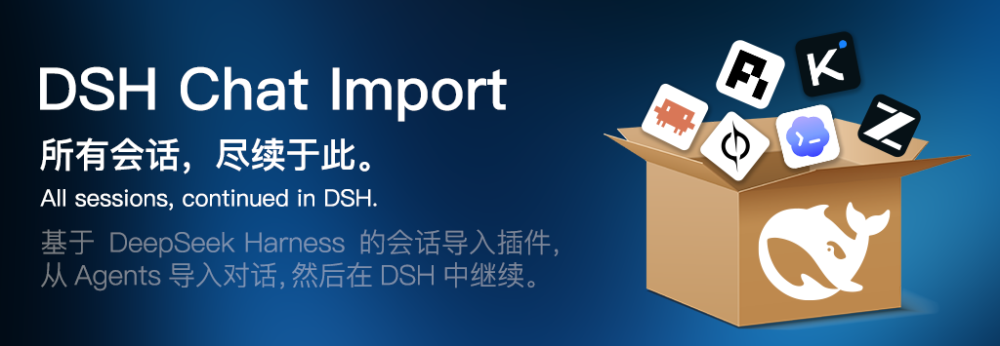

<div align="center">

# dsh-chat-114

**把各家 Harness 的对话记录移到最方便的 DSH 中进行管理**

**Move conversation history from every Harness into DSH, where you can actually find it.**

[](LICENSE)
[](https://github.com/Nwflower/dsh-chat-import)
[](#安装--installation)
[](https://nodejs.org)

</div>


---

## 简介 / Introduction
现在各家 AI 能力迭代飞快，经常免不了在不同 Harness 之间交替使用。还有是像作者这样的穷人，为了蹭点token经常在不同Harness之间捡免费额度用。而相同思路的多个对话内容分散在不同 Harness 之间难以整理就很烦。所以用源仓库[DSH Chat Import]改造得到这个插件。把各家的对话记录移到最方便的 DSH 中进行管理。

114 取“电话热线：查询电话本”意，在 DSH 中找到自己上次聊的对话在哪里后便可以想起来去哪里继续。

插件的主要功能有：

1. 检索设备上的常见 Harness 的对话记录，展示于对话记录展示窗。
2. 允许将对话记录导入 DSH 中进行读取，自动合并相同的工作区。允许已导入内容再删除。
3. 导入的对话默认只读，想要继续对话需要点击”在新对话中分支“功能让 DSH 新建对话以继续。
4. 一些智能适配。如 对话过滤器与查询的调整。多选、导入/归档状态标记。

AI moves fast, and you end up switching between Harnesses all the time. If you're like the author — broke enough to chase whatever free quota is being handed out this week — you've probably scattered the same idea across three or four tools, and keeping track of that is genuinely annoying. So this plugin is a fork of [DSH Chat Import], built to gather all those conversations into DSH, the one place where managing them is actually convenient.

The name "114" comes from the Chinese directory-assistance hotline — you dial it to look up a number. The idea: find where you left off, then carry on.

What it does:

1. Scans your machine for conversation logs from the common Harnesses and lists them.
2. Imports those logs into DSH as readable sessions, merging into a matching workspace automatically. Imported sessions can be deleted later.
3. Imported sessions are read-only by default. To keep talking, use "fork session" so DSH opens a fresh conversation you can type in.
4. A few quality-of-life touches: better filters and search, multi-select, and import/archive status markers.

## 安装 / Installation
> 还没发到 npm。

用这条命令装：

```bash
dsh plugin --profile desktop add <克隆下来的目录>
```

或者在 dsh desktop 的 插件-添加插件 输入本仓库地址。装完重启 DSH，右侧栏会多出「导入会话」入口。

**不要和原版 `dsh-chat-import` 同时安装**：两者注册同一套面板槽位和同名插件条目，极可能发生冲突。

Not published to npm yet. Install with the command above, or use **Plugins → Add plugin** in DSH Desktop and paste this repository's URL.

Restart DSH afterwards — an "Import sessions" entry shows up in the right sidebar.

**Do not install this alongside the original `dsh-chat-import`.** Both register the same panel slots and the same plugin entry, so they will almost certainly collide.

## 使用 / Usage
### 导入 / Import
1. 打开右侧栏「导入会话」，面板会自动扫描本机数据源。
2. 用顶部四个控件收窄范围：**路径**（工作区）、**时间**、**来源**（可多选，带各来源条数）、**排序**。
3. 每行最左边有个状态点：灰=未导入、绿=已导入、橙=源里有新内容、紫=已归档。
4. 勾选要的行（点整行即可，也支持全选），点底部导入。

导入时**按工作区路径自动归组**：源对话原来在哪个目录下，就落进 DSH 里同名的工作区；没有对应工作区就新建一个。

1. Open "Import sessions" in the right sidebar; it scans your local data sources automatically.
2. Narrow things down with the four controls up top: **path** (workspace), **time**, **source** (multi-select, with per-source counts), and **sort**.
3. Each row has a status dot on the far left: grey = not imported, green = imported, orange = the source has new content, purple = archived.
4. Tick the rows you want (clicking anywhere on a row works, and there's select-all), then hit Import at the bottom.

Imports are **grouped by workspace path**: a conversation lands in the DSH workspace with the same directory, and a new workspace is created if there isn't one.

### 导入之后 / After import
导入的会话是**只读**的。输入框会锁住，灰色占位文字写着「此对话来源于 <来源>·<日期>」。

想接着聊，点输入框上方横幅的**「分叉后继续对话」**（等同 DSH 原生的「分叉会话」）。DSH 会新建一个会话，那里可以正常对话，原对话保持只读。

Imported sessions are **read-only**. The input box is locked, and the grey placeholder shows where the conversation came from and when.

To continue, click **"分叉后继续对话"** on the banner above the input box — same thing as DSH's native "fork session". DSH opens a new conversation you can type in normally, while the original stays read-only.

### 删除与归档 / Delete & archive
- **删除**导入的会话不会留任何记录。下次扫描它回到「未导入」，想重导随时可以。
- **归档**的会话显示紫点。点它的导入按钮会先取消归档、再走导入，所以看到紫点不用担心。如果它原来挂的工作区被删了，导入时还会顺手把工作区重建出来。

**Deleting** an imported session leaves no trace. It shows up as "not imported" on the next scan, so you can re-import it anytime.

**Archived** sessions show a purple dot. Clicking their import button un-archives them first, then imports — so there's nothing to worry about. If the workspace they belonged to was deleted, it gets recreated along the way.

## 支持的数据源 / Supported sources
> 支持的数据源直接粘贴原仓库的数据源表格。另对CodeX和ZCode数据源进行了一些调整。

This table is copied straight from the upstream repo. Codex and ZCode have some adjustments.

<table>
  <tr>
    <td align="center" width="20%"><a href="https://github.com/anthropics/claude-code"><br /><b>Claude Code</b></a></td>
    <td align="center" width="20%"><a href="https://github.com/openai/codex"><br /><b>Codex</b></a></td>
    <td align="center" width="20%"><a href="https://github.com/google-gemini/gemini-cli"><br /><b>Gemini CLI</b></a></td>
    <td align="center" width="20%"><a href="https://github.com/aaif-goose/goose"><br /><b>Goose</b></a></td>
    <td align="center" width="20%"><a href="https://github.com/charmbracelet/crush"><br /><b>Crush</b></a></td>
  </tr>
  <tr>
    <td align="center" width="20%"><a href="https://github.com/qoderAI/qoder-cli"><br /><b>Qoder CLI</b></a></td>
    <td align="center" width="20%"><a href="https://github.com/MoonshotAI/kimi-cli"><br /><b>Kimi CLI</b></a></td>
    <td align="center" width="20%"><a href="https://github.com/MoonshotAI/kimi-code"><br /><b>Kimi Code</b></a></td>
    <td align="center" width="20%"><a href="https://github.com/esengine/DeepSeek-Reasonix"><br /><b>Reasonix</b></a></td>
    <td align="center" width="20%"><a href="https://github.com/anomalyco/opencode"><br /><b>OpenCode</b></a></td>
  </tr>
  <tr>
    <td align="center" width="20%"><a href="https://github.com/XiaomiMiMo/MiMo-Code"><br /><b>MiMo Code</b></a></td>
    <td align="center" width="20%"><a href="https://z.ai"><br /><b>ZCode</b></a></td>
    <td align="center" width="20%"><a href="https://github.com/xai-org/grok-build"><br /><b>Grok Build</b></a></td>
    <td align="center" width="20%"><a href="https://github.com/openclaw/openclaw"><br /><b>OpenClaw</b></a></td>
    <td align="center" width="20%"><a href="https://github.com/Kilo-Org/kilocode"><br /><b>Kilo Code</b></a></td>
  </tr>
  <tr>
    <td align="center" width="20%"><a href="https://github.com/badlogic/pi-mono"><br /><b>Pi Coding Agent</b></a></td>
    <td align="center" width="20%"><a href="https://github.com/can1357/oh-my-pi"><br /><b>oh-my-pi</b></a></td>
    <td align="center" width="20%"><a href="https://github.com/NousResearch/hermes-agent"><br /><b>Hermes</b></a></td>
    <td align="center" width="20%"><a href="https://cursor.com"><br /><b>Cursor</b></a></td>
    <td align="center" width="20%"><a href="https://github.com/cline/cline"><br /><b>Cline</b></a></td>
  </tr>
  <tr>
    <td align="center" width="20%"><a href="https://github.com/continuedev/continue"><br /><b>Continue</b></a></td>
    <td align="center" width="20%"><a href="https://github.com/zed-industries/zed"><br /><b>Zed</b></a></td>
    <td align="center" width="20%"><a href="https://antigravity.google"><br /><b>Antigravity</b></a></td>
    <td align="center" width="20%"><a href="https://chatgpt.com"><br /><b>ChatGPT</b></a></td>
    <td align="center" width="20%"><a href="https://github.com/gabotechs/workbuddy"><br /><b>WorkBuddy</b></a></td>
  </tr>
  <tr>
    <td align="center" width="20%"><a href="https://github.com/QwenLM/qwen-code"><br /><b>Qwen</b></a></td>
    <td align="center" width="20%"><a href="https://github.com/deepseek-ai/deepseek-harness"><br /><b>DSH</b></a></td>
    <td align="center" width="20%"><a href="https://www.teleai.com.cn/product/super-agent"><br /><b>TeleAgent</b></a></td>
    <td align="center" width="20%"><a href="https://www.trae.ai/"><br /><b>Trae Work</b></a></td>
    <td align="center" width="20%"><a href="https://www.doubao.com/download/desktop"><br /><b>豆包</b></a></td>
    <td align="center" width="20%"><a href="https://github.com/mistralai/mistral-vibe"><br /><b>Mistral Vibe</b></a></td>
  </tr>
  <tr>
    <td align="center" width="20%"><a href="#使用"><br /><b>本地 JSONL</b></a></td>
    <td align="center" width="20%"><a href="https://github.com/microsoft/vscode"><br /><b>Copilot VS Code</b></a></td>
    <td align="center" width="20%"><a href="https://github.com/github/copilot-cli"><br /><b>Copilot CLI</b></a></td>
  </tr>
</table>

DSH 自己的会话（V3 / V4）**默认不显示**。需要的话在来源筛选里勾出来，它们固定排在最后、前面有一条分割线。

DSH's own sessions (V3 / V4) are **hidden by default**. Tick them in the source filter if you need them — they always sit at the end, behind a divider.

### 关于 Codex 的压缩包 / Codex .zst
原版只认没压缩过的 `.jsonl`，而新版 Codex CLI 默认把 rollout 写成 `.zst`。本机实测 212 个 rollout 里 189 个是压缩件（占 89%），原版一个都扫不到。这一版补上了，所以 Codex 那边能看到的会话比原版多好几倍。

The original only reads uncompressed `.jsonl`, but newer Codex CLIs write rollouts as `.zst`. On the author's machine, 189 of 212 rollouts were compressed (89%) — the original couldn't see a single one of them. This fork reads them, so you get several times more Codex conversations.

## 和上游的关系 / Relationship to upstream
这个项目是 [Nwflower](https://github.com/Nwflower) 的 [dsh-chat-import](https://github.com/Nwflower/dsh-chat-import) 的 fork。33 种格式的解析、导入管线、面板骨架都是原作者写的，这部分功劳完全归他。这里改动的是下面这张表：

| 改动 | 说明 |
| --- | --- |
| Codex `.zst` | 补上压缩件的读取（原版只认未压缩 `.jsonl`） |
| 导入会话只读 | 用 DSH 官方的 `conversation.blocks` 锁住，来源写进占位文字 |
| 分叉续聊 | 走原生 `forkSession`，不额外维护状态 |
| 来源多选筛选 | 勾选型下拉、带条数、DSH 自家格式钉最后并加分割线 |
| 四态状态点 | 灰 / 绿 / 橙 / 紫，可按状态筛选 |
| 多字段排序 | 时间、创建时间、名称、来源，可切升降序 |
| 删除不留墓碑 | 原版删除会写永久墓碑，这里微调去掉此功能 |

> 只需要原版功能的话，请装上游的 [`dsh-chat-import`](https://github.com/Nwflower/dsh-chat-import)。上游原版的 README 也归档在本仓库：[English](docs/upstream/README.md) ｜ [简体中文](docs/upstream/README.zh-CN.md)。

This project is a fork of [dsh-chat-import](https://github.com/Nwflower/dsh-chat-import) by [Nwflower](https://github.com/Nwflower). The parsing for all 33 formats, the import pipeline, and the panel skeleton are his work — that credit is entirely his. Everything changed here is in the table above.

If you only need the original features, install upstream's [`dsh-chat-import`](https://github.com/Nwflower/dsh-chat-import). Upstream's README is also archived in this repo: [English](docs/upstream/README.md) | [简体中文](docs/upstream/README.zh-CN.md).

上游仓库的宣传图，原版长这样：



The upstream repo's promo banner, i.e. what the original looks like.

## 许可 / License
[MIT](LICENSE)。原作者的版权声明完整保留。

[MIT](LICENSE). The original author's copyright notice is kept intact.

[DSH Chat Import]: https://github.com/Nwflower/dsh-chat-import
